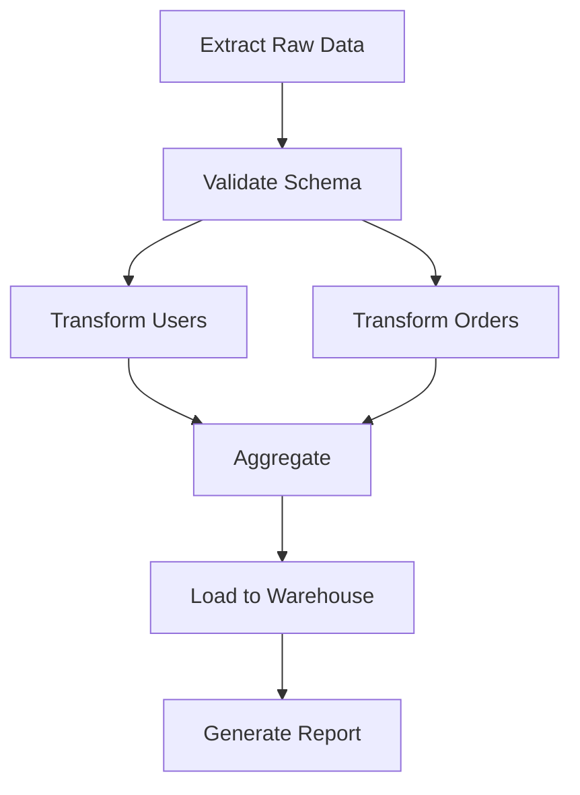

# DAG (Directed Acyclic Graph) Pattern / Coordinator Mode

## What is a DAG

A **DAG** (Directed Acyclic Graph) is a data structure consisting of **nodes** (vertices) and **edges** (directed connections) where:

- Each edge has a direction (from one node to another).
- There are **no cycles** — you cannot start at a node and follow the edges back to the same node.

In software engineering, the **DAG pattern** (also called **DAG coordinator mode**) refers to an architecture where tasks or operations are modeled as nodes in a DAG, and execution order is determined by the graph topology rather than hardcoded sequential logic.

```
    A       B
     \     /
      \   /
        C
        |
        D
       /\
      /\
     E     F
```

Node `C` depends on both `A` and `B`; node `D` runs after `C`; nodes `E` and `F` run in parallel after `D`.

---

## DAG Basics

### Directed Property

Edges have a specific direction, indicating dependency flow:

| Edge | Meaning |
|------|---------|
| A → C | "A must complete before C starts" |
| B → C | "B must complete before C starts" |

This creates a clear **dependency ordering** without prescribing a single execution path.

### Acyclic Property

No cycles mean there is always a **topological order** — a valid sequence in which all nodes can be executed. This guarantees:

- **Termination**: No infinite loops in dependency resolution.
- **Determinism**: Given the same DAG, the execution order is always the same.
- **Detectability**: Cycle detection algorithms (e.g., DFS-based) can verify validity upfront.

```python
def detect_cycle(nodes, edges):
    """Simple DFS-based cycle detection."""
    WHITE, GRAY, BLACK = 0, 1, 2
    color = {n: WHITE for n in nodes}

    def dfs(node):
        color[node] = GRAY
        for neighbor in edges.get(node, []):
            if color[neighbor] == GRAY:
                return True  # cycle found
            if color[neighbor] == WHITE and dfs(neighbor):
                return True
        color[node] = BLACK
        return False

    return any(dfs(n) for n in nodes if color[n] == WHITE)
```

### Topological Sort

The core algorithm that determines execution order:

```python
from collections import deque

def topological_sort(nodes, edges):
    """Kahn's algorithm - produces an executable order."""
    in_degree = {n: 0 for n in nodes}
    for u in edges:
        for v in edges[u]:
            in_degree[v] += 1

    queue = deque(n for n in nodes if in_degree[n] == 0)
    result = []

    while queue:
        node = queue.popleft()
        result.append(node)
        for neighbor in edges.get(node, []):
            in_degree[neighbor] -= 1
            if in_degree[neighbor] == 0:
                queue.append(neighbor)

    if len(result) != len(nodes):
        raise ValueError("Cycle detected!")
    return result
```

---

## Why Use DAG? Advantages Over Linear/Tree Structures

### vs Linear Pipeline

| Aspect | Linear Pipeline | DAG |
|--------|----------------|-----|
| Structure | Single chain: A → B → C → D | Arbitrary dependencies |
| Parallelism | None (strictly sequential) | Maximal (independent nodes run concurrently) |
| Flexibility | Fixed order | Dependency-driven order |
| Reusability | Low | High (nodes can be shared across paths) |
| Failure Recovery | Restart from beginning | Restart from failed node + re-run downstream |

**Key advantage**: DAGs enable **maximal parallelism** for independent tasks. In a linear pipeline, task D waits for A, B, AND C sequentially. In a DAG, A→D, B→D, C→D allow all three to run in parallel before D starts.

### vs Tree Structure

| Aspect | Tree | DAG |
|--------|------|-----|
| Node sharing | Each node appears once | Nodes can appear multiple times (shared results) |
| Expression coverage | Cannot express diamond patterns | Naturally handles diamond dependencies |
| Complexity | Simpler but less expressive | More flexible, handles complex scenarios |

```
        Diamond dependency (tree breaks this!):

        DAG:              Tree: (can't share D!)
        A   B             A       B
         \ /             / \     /\
          D            D   X   Y   D
          |            |           |
          C            C           C
```

### Key Advantages Summary

1. **Parallelism**: Independent branches execute concurrently → faster completion.
2. **Dependency clarity**: Visual and explicit dependency relationships.
3. **Fault tolerance**: Can retry failed nodes and propagate success/failure efficiently.
4. **Reusability**: Common sub-graphs can be shared as templates/nodes.
5. **Optimization opportunities**: Scheduling, caching, and resource allocation based on graph structure.
6. **Composability**: Small DAGs can be composed into larger ones.

---

## Application Scenarios

### 1. CI/CD Pipelines

**GitHub Actions**, **GitLab CI**, **Jenkins pipelines**:

```yaml
# GitHub Actions example - a DAG of jobs
jobs:
  test:           # Job A
    runs-on: ubuntu-latest
    steps: [...]

  lint:           # Job B (runs in parallel with test)
    runs-on: ubuntu-latest
    steps: [...]

  build:          # Job C (depends on A & B via needs:)
    needs: [test, lint]
    runs-on: ubuntu-latest
    steps: [...]

  deploy-staging:  # Job D (depends on C)
    needs: build
    runs-on: ubuntu-latest
    steps: [...]

  deploy-prod:    # Job E (depends on D, with manual gate)
    needs: deploy-staging
    if: github.ref == 'refs/heads/main'
    runs-on: ubuntu-latest
    steps: [...]
```

Execution order: `{test, lint} → build → deploy-staging → deploy-prod`

### 2. Workflow Engines

**Apache Airflow**, **Prefect**, **Luigi**:

```python
# Apache Airflow example using PythonOperator
from airflow import DAG
from airflow.operators.python import PythonOperator
from datetime import datetime

default_args = {"owner": "data-engineer", "retries": 2}

with DAG(
    "data_pipeline",
    default_args=default_args,
    schedule_interval="0 2 * * *",
    start_date=datetime(2024, 1, 1),
) as dag:

    extract = PythonOperator(
        task_id="extract_data",
        python_callable=run_etl_extract,
    )

    transform_a = PythonOperator(
        task_id="transform_user_data",
        python_callable=transform_users,
    )

    transform_b = PythonOperator(
        task_id="transform_order_data",
        python_callable=transform_orders,
    )

    combine = PythonOperator(
        task_id="combine_datasets",
        python_callable=merge_results,
    )

    load = PythonOperator(
        task_id="load_to_warehouse",
        python_callable=load_warehouse,
    )

    validate = PythonOperator(
        task_id="validate_output",
        python_callable=validate_data,
    )

    # DAG dependencies
    [extract] >> [transform_a, transform_b] >> combine >> load >> validate
```

### 3. ML Pipelines

**MLflow Pipelines**, **Kubeflow Pipelines**, **Apache Beam**:

```python
# Kubeflow Pipelines example
from kfp import dsl

@dsl.component(base_image="python:3.11")
def preprocess(data_path: str) -> dsl.Output[str]:
    ...

@dsl.component(base_image="python:3.11")
def train_model(preprocessed_data: str, model_type: str = "xgboost"):
    ...

@dsl.component(base_image="python:3.11")
def evaluate(model_path: str, test_data: str) -> float:
    ...

@dsl.pipeline(name="ml-training-pipeline")
def training_pipeline():
    data = preprocess(data_path="/data/raw/")
    model = train_model(preprocessed_data=data.output, model_type="xgboost")
    score = evaluate(model_path=model.output, test_data="/data/test/")

# Behind the scenes: preprocess → train_model → evaluate
```

### 4. Data Processing

**Apache Airflow**, **Spark DAG**, **Flink**:

```python
# Spark DataFrame operations form an implicit DAG
df = spark.read.csv("hdfs://path/to/data")
df_filtered = df.filter(df["age"] > 18)
df_grouped = df_filtered.groupBy("city").count()
df_sorted = df_grouped.orderBy(col("count").desc())
df_sorted.write.parquet("hdfs://output/path")

# Spark optimizes this into a single optimized DAG execution plan
# Pushing down filters, combining stages, etc.
```

### 5. Build Systems

**Bazel**, **MESON**, **Make**, **Gradle**:

```python
# MESON build definition - implicitly defines a DAG of build targets
project('myproject', 'c')

# Dependencies between targets form a DAG:
# hello_lib.o → libhello.so
# main.o → myapp (links against libhello.so)

lib_hello = shared_library('hello', 'hello.c')
executable('myapp', 'main.c', link_with: lib_hello)
test('unit_test', 'test_main.c')

# Bazel build automatically determines parallel build order
```

---

## Comparison with Alternative Patterns

### Linear Pipeline

```
A → B → C → D → E
```

- **Pros**: Simple, predictable, easy to debug.
- **Cons**: No parallelism, poor utilization, rigid.
- **Best for**: Strictly sequential processes (e.g., assembly line).

### Tree Structure

```
        root
       / |\
      A  B  C
     /\
    D   E
```

- **Pros**: Hierarchical, intuitive branching.
- **Cons**: No shared nodes, limited re-use.
- **Best for**: File systems, organizational charts, inheritance hierarchies.

### General Graph (with cycles)

```
A → B → C → A  (cycle!)
```

- **Pros**: Most expressive.
- **Cons**: Requires cycle handling, potential infinite loops.
- **Best for**: State machines, social networks (not task orchestration).

### DAG Pattern

```
A   B
 \ /
  C   D
  | /
  E   F
```

- **Pros**: Expressive yet safe, enables parallelism, deterministic execution.
- **Cons**: More complex to implement; requires topological sort.
- **Best for**: Task orchestration, build systems, workflow engines — **wherever you need dependency-aware execution**.

---

## Best Practices

### 1. Keep Nodes Idempotent

Each node should be **idempotent** — running it multiple times produces the same result. This enables retries and partial re-execution safely.

```python
# Good: idempotent
def process_data(data_dir):
    # Always reads/writes deterministically
    return standardized_result

# Bad: non-idempotent
def send_notification(user):
    # Side effect: could double-send
    email_service.send(user.email, "Hello!")
```

### 2. Define Clear Input/Output Contracts

Each node should have well-defined inputs and outputs, typically through data products or artifacts.

```python
@task(output_schema={"users_df": pd.DataFrame, "metadata": dict})
def etl_user_data(raw_path: str) -> dict:
    ...
```

### 3. Minimize Direct Dependencies

Keep each node's incoming edges minimal. Excessive fan-in creates bottlenecks. Use intermediate aggregation nodes if needed.

### 4. Handle Failures Gracefully

Implement retry policies, timeout limits, and failure propagation rules:

```python
# Example: per-node retry configuration
config = DAGConfig(
    default_retry_policy=RetryPolicy(max_retries=3, backoff="exponential"),
    timeout=timedelta(hours=2),
    failure_strategy="fail_fast",  # or "skip_failed", "continue"
)
```

### 5. Enable Incremental Execution

Support partial DAG re-execution: skip already-successful nodes and only re-run from the failed point.

### 6. Visualize and Document

Always maintain visual representations of DAGs. Tools like Mermaid, Graphviz, or UI-based DAG viewers help teams understand workflows.



### 7. Avoid Circular References Early

Validate DAG integrity during design, not at runtime:

```python
# Validate at import time
dag.validate()  # Raises error if any cycles exist
```

### 8. Resource-Aware Scheduling

Modern DAG engines support:
- **Resource pools** (GPU, memory constraints)
- **Priority scheduling** (critical paths first)
- **Budget controls** (max concurrent nodes)

---

## Future Trends

### 1. AI-Generated DAGs

LLMs are increasingly used to:
- **Generate DAGs from natural language**: "Build a pipeline that ingests CSV data, trains an ML model, and deploys it."
- **Optimize existing DAGs**: Auto-reordering nodes for better parallelism.
- **Auto-detect errors**: Identifying missing dependencies or redundant nodes.

### 2. Cloud-Native DAG Orchestration

Platforms evolving toward full Kubernetes-native DAG execution:
- **Kubernetes Operators** wrapping DAG runners
- **Serverless DAG execution** (pay-per-node)
- **Edge computing DAGs** (distributed across cloud + edge devices)

### 3. Real-Time DAG Streaming

Moving beyond batch-oriented DAGs to real-time event processing:
- **Stream-processing DAGs** that adapt dynamically
- **Event-sourced DAG state** for audit trails
- **Continuous DAG evaluation** (DAG changes as events arrive)

### 4. Multi-Cloud DAG Execution

Cross-cloud DAG orchestration:
- Nodes deployed to different cloud regions/providers
- Cost-aware node placement optimization
- Compliance-aware scheduling (GDPR, HIPAA regions)

### 5. Self-Healing DAGs

Autonomous recovery capabilities:
- Automatic node replacement when hardware fails
- Dynamic rescheduling based on resource availability
- Predictive failure prevention via ML monitoring

---

## Quick Reference

| Concept | Description |
|---------|-------------|
| **Topological Sort** | Algorithm to determine valid execution order |
| **Critical Path** | Longest path through DAG — determines minimum total execution time |
| **Fan-In / Fan-Out** | Number of incoming/outgoing edges for a node |
| **Isolated Subgraph** | A subset of nodes with no external dependencies |
| **Memoization** | Cache successful node results to avoid re-execution |
| **DAG Size Limit** | Practical limit on nodes/edges (usually thousands to millions) |

---

*This document covers the DAG pattern as a coordination mechanism in software systems. It is applicable across CI/CD, data engineering, ML ops, build systems, and general workflow automation.*
